<picture>
  <source media="(prefers-color-scheme: dark)" srcset="assets/banner-dark.svg">
  <source media="(prefers-color-scheme: light)" srcset="assets/banner-light.svg">
  
</picture>

I build software for a living, and I like it best when it quietly takes a chore off someone's plate. I care about software that is fast, calm, and honest about what it doesn't know.

- Colombo, Sri Lanka
- Full stack, cloud and event-driven systems by day
- Evenings: helping small businesses automate the boring part, such as supplier invoices into accounting software
- Exploring: agent harnesses, MCP, and how AI agents should use tools safely with a person approving the risky steps

### Toolbox

`Java` `Spring Boot` `TypeScript` `React` `Node.js` `PostgreSQL` `AWS Lambda` `EventBridge` `OpenFGA` `Python`

### Featured

**[gigi](https://github.com/ChandimaEkanayake/gigi)** is my personal agentic development team: specialised AI agents (discovery, architect, developer, QE and more) working as a delivery team, built on the open-source Pi agent harness in TypeScript. Early development, MIT licensed.

### A note on the rest

Most of my professional work (an access-control platform and serverless data pipelines) is private, so it isn't here. Older university projects on this account are archived.
